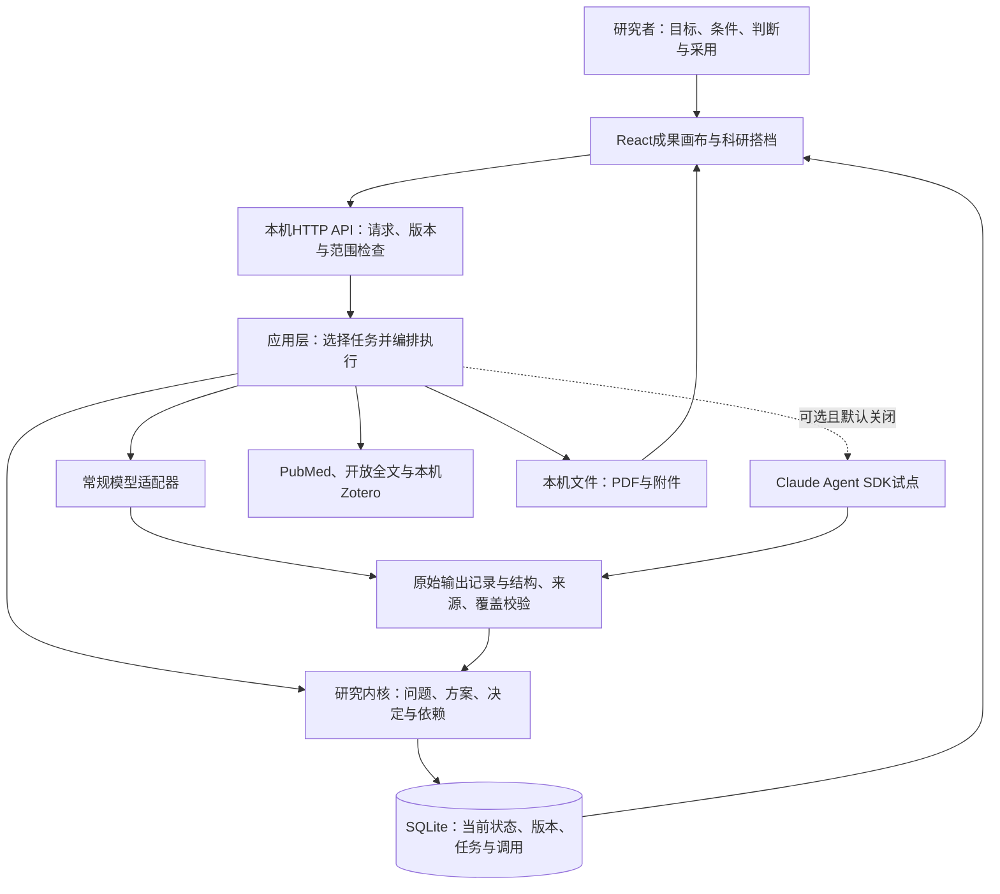
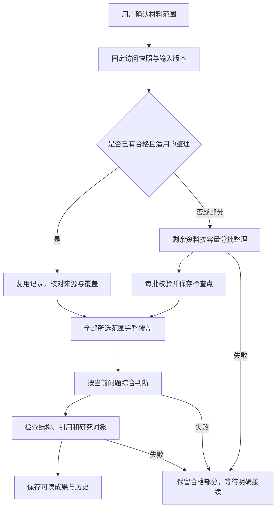

# 科研工作台 v0.34.6 架构介绍

依据：v0.34.6源码、能力接口与现有运行记录，核对日期2026-09-21。操作方法见[使用说明](user-guide-v0346.md)，审查和性能边界见[升级报告](green-review-v0346.md)。

## 1. 产品结构与设计责任

当前产品是“本机优先的模块化单体”：一个本机Node服务承接前端、API、科研任务与持久化，内部按职责拆模块。浏览器展示成果，外部模型提供语言推理，SQLite与文件目录保存研究记录。

程序负责工具调用、记录、版本和校验；模型负责候选、比较、解释和拟议方案；研究者负责科学选择、采用与真实执行。研究状态由工作台持有，模型输出不能直接获得数据库或采用权限。

“v2.0”是第二代产品目录与界面名称，`0.34.6`是当前软件版本。开发工作台所用的Codex模型，与工作台执行科研任务时调用的模型，是两个不同配置。架构不绑定开发助手的智能程度。

## 2. 总体结构



图中的模块不是独立微服务。当前没有消息队列集群、向量数据库、通用科学执行沙箱或自动多Agent管理台。后台有并行批次，但它们仍归同一个任务和同一份研究状态管理。

## 3. 实际技术栈

| 部分 | 实现 | 用途 |
|---|---|---|
| 界面 | React 19.2.8 | 成果画布、阅读、编辑、侧栏和状态反馈 |
| 构建 | Vite 7.3.6 | 开发与生产前端构建 |
| 服务 | Node.js，当前要求22.23.1或兼容更新版本 | 本机HTTP接口、编排与文件操作 |
| 数据库 | better-sqlite3 13.0.3 + SQLite | 本机事务、版本、日志与任务保存 |
| 结构验证 | Ajv；SDK工具使用Zod | 校验已定义输出合同和工具输入 |
| PDF | pdfjs-dist | PDF文字提取、分页和浏览器显示 |
| 图表与图稿 | Chart.js、SVG、Canvas | 结果展示、数据图及可编辑图稿 |
| 可选运行方式 | Claude Agent SDK 0.3.278 | 候选比较和研判试点，默认关闭 |

主模型由本机设置提供，当前界面已实现GLM-5.3-Flash的专门思考档位与生成额度逻辑。其他模型走兼容接口，不注入未经核对的同款参数；地址兼容不等于所有高级能力都兼容。

## 4. 界面层：围绕成果组织交流

`App.jsx`管理课题列表、新建与画像入口。`Workspace.jsx`组织当前成果、材料、阅读位置、讨论、版本、任务和模型设置。

专门组件承担领域图解、候选比较、专题筛选、大纲、正文、模板PDF、研究方案和图稿。侧栏讨论引用当前对象，避免用户每次重新复制题目和版本。

浏览器的临时输入保存在localStorage；服务确认后的正式内容以SQLite为准。React状态负责当前显示，不是第二套持久研究事实库。

v0.34.6对两个高频行为做了局部优化：

- 单任务轮询带ETag；状态未变化时服务器返回304，浏览器保留现有对象。
- 保存批次先显示摘要，展开某批后才渲染具体文献。已保存的研判提取记录也进入同一阅读入口。

这改善等待与阅读开销。首次完整课题加载、变化后的完整任务返回及大状态写入仍有成本，尚未全部改为增量接口。

## 5. API与研究内核：保证对象和操作准确

API先检查请求来源、课题归属、对象引用、请求格式和版本前提。写请求携带唯一请求编号，用于识别重复请求；编辑携带基准版本，发现并发修改时提示冲突。

研究内核管理的对象可以按如下方式理解：

| 对象 | 作用 | 不能混为一谈的内容 |
|---|---|---|
| 课题 | 原始目标、当前目标、画像、条件与研究空间 | 课题名不等于已经确定的科学问题 |
| 来源与访问快照 | 来源身份及某次真正取得的题名、摘要、片段、全文 | 同一论文不等于所有版本、所有访问层级相同 |
| 科研问题与主张 | 候选题目、问题表达、依据与版本 | AI候选不等于已经采用 |
| 成果 | 简报、比较、大纲、正文、图稿等用户阅读对象 | 页面显示的最新稿不一定是正式采用版 |
| 方案与研究记录 | 方案、执行、解释、建议、附件 | 拟议方案不等于执行事实 |
| 用户决定 | 采用、保留、不采用、未决等取舍 | 保存或打开一份内容不等于采用 |
| 任务、尝试与调用 | 一轮工作、内部尝试、工具与模型请求 | 一个用户任务不等于一次物理模型调用 |
| 依赖与影响 | 某成果使用了哪个问题、方案、结果或材料版本 | 没有记录的关系不能推定已检查 |

版本保存是内容历史，采用是独立决定。恢复旧内容产生新版本，不能悄悄删除中间版本或恢复旧决定。上游变化会标出已知下游影响，供用户核对。

核心逻辑由`kernel.mjs`、`continuity.mjs`和共用引用函数实现。数据库不能由模型直接修改，模型提供的引用与拟议动作也必须经过服务端检查。

## 6. 应用层：有界编排，不自由执行全部研究

`research-application.mjs`接收任务，取得准确输入，选择处理器，记录调用，调用相应工具，检查输出并保存。`workflows.mjs`提供批次、覆盖、引用、生命周期和复用等共用机制。

处理器覆盖范围澄清、检索、领域分析、候选比较、题目研判、专题收集和筛选、大纲、写作、模板分析与图稿关系整理等。不是每个功能都进入同一套模型循环：检索、手工图稿、保存和导出等大量操作由程序直接完成。

输入快照包括用户问题、所选成果与版本、当前采用内容、现实条件、所选访问材料和相关讨论。旧AI回答可以用于接续，但不能冒充原始文献。程序不会无条件把整个项目的所有聊天都当作本次材料。

### 大批文献路径



默认逻辑批次50篇、并发2批，可按设置调整。模型实际输出容量不足时，可以把未完成部分拆小；合格单篇与片段保留。只有所选范围完整覆盖后才进入完整综合；最终综合过大也应明确失败，不能省掉尾部论文。

修订复用来自选定报告或准确来路版本。核对模型、来源、访问层级和文本；旧“与本问题相关性”在新投影中清空，重新判断。原记录不变，复用不称作本轮新核验。

### 选题与方案研判路径


只查已有材料时，补检环节不会执行外部检索。允许补查时仍围绕本轮关键问题；检索无结果不能推出无人研究。初判保留当时局部范围，后续阶段记录新的实际范围，不篡改旧输入。

`question-investigation.mjs`维护这一有界循环，调用的是现有检索、提取、全文与保存能力，没有另建研究数据库或无限递归评审机制。

## 7. 模型与验证层

常规模型适配器处理配置、请求、流式接收、取消、结束原因和实际用量；专门的模型配置逻辑处理已验证供应商参数。提示规范与任务数据由科研模块构造，不直接把开发助手的根AGENTS.md当科研任务提示。

关键顺序是：**原始输出留证 → 结构解析 → 适用的输出合同检查 → 来源／覆盖／领域语义检查 → 形成候选成果**。

Ajv用于已有明确合同的逐篇整理、研判等输出；其他研究任务还使用各自的领域验证器，并不是所有输出都由同一个万能JSON Schema裁决。

v0.34.6的兼容只允许可解释的确定性转换，例如字符串列表转项目符号、定位指定段落内唯一精确短引文。输入引用编号、原始输出和转换说明仍保留。格式修复不会为缺失研究补写数字、编造引文或把未完成实验改成完成。

校验分工及盲区：

| 检查 | 能证明 | 不能证明 |
|---|---|---|
| JSON与字段结构 | 输出可被程序按合同读取 | 文字中的研究推论成立 |
| 访问范围 | 引用对象属于实际给定材料 | 该材料覆盖全部领域 |
| 精确摘录 | 摘录存在于保存文本并能定位 | 摘录真正支持旁边主张 |
| 逐篇覆盖 | 所选资料已按处理合同完整整理 | 每项提取都无理解错误，或已读全文 |
| 版本与状态 | 结果对应当时输入，操作没有静默覆盖 | 推荐题目一定值得做 |
| 人工质量比较 | 记录研究者对具体输出的评价 | 独立科学真实性认证 |

## 8. Claude Agent SDK的位置

试点默认关闭。启用后，仅用于候选比较和研判中的初判、质疑、修订；大批逐篇提取和其他现有任务继续使用原路径。

试点有独立模型与服务配置、隔离运行目录，并提供本轮材料目录和原文读取两个受控工具。禁用一般终端、任意文件工具和项目／用户设置加载；研究规则由本轮程序构造，降低开发规则混入科研的风险。

SDK输出仍交回原验证与研究内核。它没有写数据库、自动采用方案或任意执行科研代码的权限。外部补检仍由现有应用层按授权范围调度。

常规OpenAI兼容端点不能直接当作SDK所需的Anthropic兼容端点，原密钥不会自动迁移。当前试点已做本机模拟服务验证，真实供应商、成本与科研质量仍需单独验证。启用方法见[试点说明](agent-pilot-v0343.md)。

## 9. 持久化、恢复与数据边界

SQLite承载课题、对象、不可变版本、序列、事件、请求回执、模型调用与存储元信息。对象载荷使用JSON列保存，不是每个科研字段都拆成独立关系表，也不是简单把整库存成一个JSON文件。

业务修改、版本、事件和回执以事务保存。数据库采用WAL及完整同步；同一数据目录由一个服务进程持有写锁，进程内写操作串行化。旧JSON仅用于兼容迁移及核对，不是另一套同步活动数据库。

后台启动会做已有数据维护，例如补齐已经存在成果的版本依赖。v0.34.6部署中曾由旧维护逻辑补齐34条关联；原内容没有改写，该行为已在旧代码副本重现。升级报告保留了这项变化，没有把它写成零变更。

停止和恢复遵守以下规则：

- 请求已受理后先有持久任务记录，再开展工作；浏览器断开不自动生成第二个任务。
- 失败和取消保留原始响应、用量、检查点与原因，不把未知状态伪装成成功。
- 批次首错停止派发新的工作，处理已在途结果；用户取消后不接纳晚到结果为新的有效成果。
- 用户继续未完成任务时复用合格阶段与材料。完整已保存响应可先本地重验，合格才省去新的模型调用。
- 研究条件或采用内容变化后，旧结果保留原输入身份，不覆盖新的研究状态。

数据目录中另存PDF、研究附件及私有模型设置。文件使用内容哈希校验身份与完整性。附件存在不等于模型已经读取；记录正文、模板读取文本和二进制文件有不同作用。

密钥文件独立保存、限制文件访问，不进入正常项目导出。当前不是密码保险箱或企业密钥托管系统。本机API做回环地址及请求来源检查，不提供多人账号和租户隔离；不能直接开放公网当多人平台使用。

## 10. 项目目录与模块职责

```text
research-workbench-v2.0/
  demo-app/
    src/                 页面、阅读、图稿、讨论与编辑组件
    server.mjs           生产静态页面和开发服务入口
    dist/                构建产物，不是源码
  demo-api/
    src/
      server.mjs         本机接口与请求边界
      kernel.mjs         研究问题、成果、决定与依赖
      continuity.mjs     方案、记录、采用、影响与质量记录
      research-application.mjs  任务编排和结果接回
      workflows.mjs      批次、引用、覆盖与生命周期
      extraction-reuse.mjs    修订时的准确来源复用
      question-investigation.mjs  题目与方案研判
      model-adapter.mjs  常规模型请求及响应
      model-contracts.mjs     输出结构合同
      model-output.mjs   输出解析与受限格式恢复
      agent-pilot.mjs    可选SDK试点
      sqlite-store.mjs   SQLite持久化、备份与写锁
      template-fulltext.mjs  全文获取与PDF解析
      zotero.mjs         本机Zotero连接
      research-files.mjs     通用附件存取
      topic-*.mjs        专题检索、阅读、大纲与写作
    test/                隔离工程回归
    .local/              本机私有运行目录，不公开提交
  shared/                前后端共用的引用、任务语义和展示合同
  scientific-assets/     作图素材及逐项来源、许可
  docs/                  使用说明、架构、实现与验证边界
  package.json           运行、构建和检查命令
  package-lock.json      依赖版本锁定
```

源码目录、构建产物和当前运行快照必须分清。本机生产服务可能从`.local/releases/`下的已验收快照运行；编辑源码或Git推送不会自动改变正在运行的后端，也不会自动把本机课题上传GitHub。

## 11. 主要API与开发运行

| 接口 | 作用 |
|---|---|
| `GET /api/capabilities` | 当前模型公开配置、存储和工程能力 |
| `GET/POST /api/projects` | 课题列表与创建 |
| `GET /api/projects/:id` | 当前完整工作区 |
| `GET /api/projects/:id/research-state` | 研究状态投影 |
| `POST /api/projects/:id/commands/:command` | 有对象与版本前提的修改 |
| `POST /api/projects/:id/research-tasks` | 开始当前研究任务 |
| `GET /api/projects/:id/research-tasks/:taskId` | 单任务状态；支持ETag条件读取 |
| `POST /api/projects/:id/research-tasks/:taskId/stop` | 停止任务并保留记录 |
| `POST /api/projects/:id/research-tasks/:taskId/revalidate` | 明确发起本地输出重验 |
| `POST /api/projects/:id/provenance` | 取得指定版本的依据清单 |

任务接口并非任意工具调用入口。请求体使用准确对象与版本，服务端验证作用域，部分命令需要基准状态版本，写请求使用`X-Request-Id`回执防重。完整边界见[API说明](../demo-api/README.md)。

新安装且没有同数据目录活动服务时，在产品根目录执行：

```sh
npm ci
npm test
npm run build
npm start
```

开发模式使用`npm run dev`。本机现有配置使用4320；没有环境覆盖时，默认端口为4318，默认数据目录为`demo-api/.local`。`RW_DEMO_DATA_DIR`决定实际数据目录，`RW_DEMO_PORT`决定端口。不能为了启动新版重复开启一个进程写同一个目录。

根启动脚本加载`.env`与Node环境代理。环境代理解决连接问题，不替代模型密钥和任务材料范围配置。公开包提供`.env.example`，实际`.env`、运行数据和密钥不入公开载荷。

升级应先核对活动任务，确认空闲，做一致备份，构建和验证新快照，再切换服务并核对数据库。恢复应在新目录验证备份；SQLite热备份要使用一致性接口，附件目录也要单独保留。

## 12. Ponytail在当前架构中的具体体现

| 选择 | 原因 |
|---|---|
| 保留Node科研内核 | JSON格式失败不由编程语言决定；既有状态和版本已可复用 |
| 复用SQLite查询与事务 | 单任务性能问题先缩小读取范围，不立即引入第二套缓存或数据库 |
| 采用HTTP条件请求与React按需渲染 | 使用成熟的小机制减少重复工作 |
| 使用现有PubMed、Zotero、PDF和作图库 | 工作台专注研究接续，不重做全部专业工具 |
| SDK作为可选适配器 | 试验另一种推理方式，保留原状态和采用权 |
| 复用准确来路的材料记录 | 避免每次改变问题都从头整理，来源与旧判断仍可追踪 |
| 真实质量评价单独保留 | 测试数、调用数、字数和文献数不能充当科研效果 |

## 13. 当前架构的局限

高频轮询已变轻，但大课题的全量首次加载、写入和最终综合仍可能很重。模型输入里可能存在重复原文、阶段背景与长记录，后续要先测量，再在完整覆盖不变的条件下减少重复；不能把未经核查的摘要压缩当作无损证据。

当前没有持久Python/R运行环境、Notebook调度、自动统计检验、实验室或HPC控制，也没有跨机构协作与正式多租户权限。方案与结果记录提供接续能力，不代表这些专业执行系统已经实现。

自动引用校验主要判断来源身份、范围和精确位置，不能充分判断因果、研究可比性、偏倚、创新性或结论强度。自然语言动作也是有限确定性适配，复杂意图仍可能需要用户明确入口或精确编辑。

已通过的403项回归、生产构建和界面检查证明工程行为的相应部分；六类真实科研质量用例及研究者认可仍待完成。现阶段的合理目标是让一个真实课题连续推进、减少重复工作，并拿出判断改善的具体证据。
